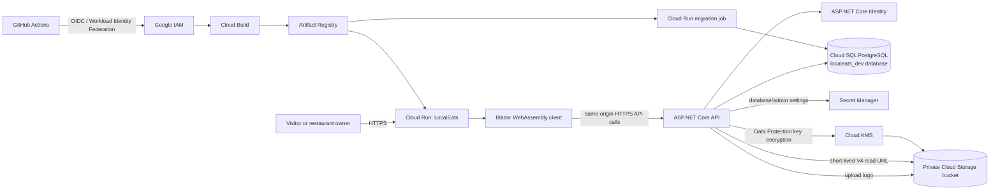

# LocalEats Google Cloud Deployment Guide

This guide is for the handoff copy at `outputs/LocalEats-Handoff`. It describes the code and Google Cloud work needed to deploy LocalEats as a separate Cloud Run service alongside ListLift.

**Status:** application groundwork is in progress. No LocalEats Google Cloud resources have been created. Commands are for Google Cloud Shell and use the project and region already used by ListLift:

- Project: `project-2d1307cc-ca8a-4589-b39`
- Region: `europe-central2`
- Existing PostgreSQL instance: `listlift-dev-pg`

The proposed Development deployment reuses that PostgreSQL *instance* to limit extra infrastructure, while giving LocalEats its own database, database login, bucket, KMS key, secrets, Cloud Run service, and runtime service account. Reuse means the apps share instance capacity and billing; it does not mean sharing their data. Production should use separate production resources, ideally in a separate Google Cloud project.

The earlier Azure and MonsterASP hosting notes in `NEXT_STEPS.md` do not apply to this Google Cloud path.

## Target architecture



The initial deployment should serve the Blazor files and API from **one Cloud Run origin**. That avoids cross-origin browser calls and matches the working ListLift deployment pattern. The API remains internet-reachable for public restaurant browsing and registration; owner authorization stays enforced by the API.

## Important prerequisite: upgrade to supported .NET

The handoff started on .NET 8 for the API and .NET 9 for the Blazor client. Both versions reached end of support on November 10, 2026. The project files have now been retargeted to .NET 10 and their Microsoft framework packages updated to the current .NET 10 servicing line. **The Release solution build succeeded on November 12, 2026.** Six existing nullable-reference warnings remain in test files. Microsoft lists .NET 10 LTS as active through November 14, 2028: [official .NET support policy](https://dotnet.microsoft.com/en-us/platform/support/policy/dotnet-core).

## Destructive-command safeguard (complete before deployment)

LocalEats controller actions using HTTP `DELETE` must require both an authenticated account in the `Admin` role and a high-entropy credential kept in a DPAPI-encrypted file on your Windows account. The API stores only its SHA-256 hash. The controller convention applies this check to every HTTP `DELETE` action, including future ones. Any future destructive command using another HTTP verb must use the same authorization filter explicitly.

Initialize the laptop credential from the project root in PowerShell:

```powershell
powershell.exe -NoProfile -ExecutionPolicy Bypass -File .\tools\Initialize-LocalEatsAdminCredential.ps1
```

The script saves the encrypted credential under `%LOCALAPPDATA%\LocalEats`, stores its hash in API User Secrets, and prints the hash for transfer to Cloud Shell. Never share the decrypted credential. Create the Secret Manager entry and add its first version from Cloud Shell:

```bash
PROJECT="project-2d1307cc-ca8a-4589-b39"
REGION="europe-central2"

gcloud secrets create LOCALEATS_DESTRUCTIVE_COMMAND_HASH \
  --project="$PROJECT" \
  --replication-policy=user-managed \
  --locations="$REGION"

read -rsp "Paste the SHA-256 hash from the local PowerShell output: " DESTRUCTIVE_HASH
echo
printf '%s' "$DESTRUCTIVE_HASH" | gcloud secrets versions add LOCALEATS_DESTRUCTIVE_COMMAND_HASH \
  --project="$PROJECT" \
  --data-file=-
unset DESTRUCTIVE_HASH

gcloud secrets add-iam-policy-binding LOCALEATS_DESTRUCTIVE_COMMAND_HASH \
  --project="$PROJECT" \
  --member="serviceAccount:localeats-runtime@${PROJECT}.iam.gserviceaccount.com" \
  --role="roles/secretmanager.secretAccessor"
```

Bind it to the API as `Admin__DestructiveCommandCredentialHash` when deploying. Do not put the hash directly in `--update-env-vars` or a committed file.

Use `tools/Invoke-LocalEatsDestructiveCommand.ps1` from that Windows account for destructive API actions. It requires HTTPS, prompts for the Admin login and password, and asks you to type `DELETE` before sending the request with `X-LocalEats-Admin-Key`. The encrypted file is machine/user bound; copying it to another laptop will not work. If the file is lost, revoke the old Secret Manager version, initialize a new credential, and deploy the new hash.

Google Cloud resource deletion is a separate IAM control. Keep the runtime identity and both GitHub deployer identities out of `Owner`/`Editor` and do not grant them resource-delete permissions. Grant create/update/deploy permissions only as needed. Review project and resource IAM bindings with `gcloud` before deployment, and ensure your Google account is the only human principal with permission to delete the LocalEats resources. Cloud IAM authorizes Google identities, so anyone who can use your Google account can exercise those permissions; the laptop credential does not intercept direct `gcloud` calls.

## Step-by-step plan

### 1. Choose the GitHub repository for this handoff copy

`LocalEats-Handoff` has no `.git` metadata. Keep it in a separate LocalEats repository, or deliberately migrate it into `Restaurants.API.Final` after reviewing that repository’s current content. Do not overwrite a repository unintentionally. The workflow examples below use `<OWNER>/<REPO>` until the repository is chosen.

Before pushing, review `.gitignore` and confirm that appsettings secrets, database files, `bin`, `obj`, publish output, and local logs are excluded. Keep the existing local deployment plan edits separate from application code changes.

### 2. Upgrade the solution to .NET 10 LTS

Update all projects and tests in `Restaurants.API.sln` to `net10.0`. Align Microsoft ASP.NET Core, Identity, EF Core, and test packages with the .NET 10 servicing line. Update the WebAssembly packages and the CI SDK setup. Review third-party package advisories during the upgrade.

Use the PostgreSQL provider whose major version matches EF Core 10. The Infrastructure project still carries the SQL Server provider and Azure Blob Storage for the existing local path; Azure Blob Storage will be replaced with GCS in the storage step.

Run these from the repository root after package and framework changes:

```powershell
dotnet --info
dotnet restore .\Restaurants.API.sln
dotnet build .\Restaurants.API.sln --no-restore -c Release
dotnet test .\Restaurants.API.sln --no-build -c Release
dotnet list .\Restaurants.API.sln package --vulnerable --include-transitive
```

The restore and Release build succeeded after the framework changes. Run the same commands after provider/migration changes. Resolve build and test failures before creating cloud resources.

### 3. Make the API and client Cloud Run ready

Implement these changes in focused commits, keeping the existing layer boundaries:

1. **Database provider and migrations:** PostgreSQL provider selection is implemented through `Database:Provider` (`SqlServer` remains the local default; `PostgreSql` selects the cloud provider). The PostgreSQL package is added. Run restore and Release build after the latest design-time configuration change.
2. **Separate migration history:** the existing `src/Restaurants.Infrastructure/Migrations` contains SQL Server migrations. EF migrations are provider-specific. A separate `Restaurants.PostgreSqlMigrations` project and design-time context factory are in place. The PostgreSQL `InitialPostgreSql` migration has been scaffolded in that project; it does not touch a database. Do not mix PostgreSQL migrations into the SQL Server migration assembly.
3. **One-off migration command:** a `Restaurants.Maintenance` project now has a `migrate-postgresql` command. API startup migration is limited to Development, and sample KFC/McDonald’s seed data is Development-only. Generate the PostgreSQL migration, compile it, then deploy and execute this command through a Cloud Run Job before moving the API service to the new image.
5. **Google Cloud Storage:** implemented a provider-neutral `IRestaurantLogoStorage` contract, retained Azure Blob Storage for local development, and added a GCS adapter selected by `Storage:LogoProvider=GoogleCloudStorage`. GCS stores object keys in `Restaurant.LogoUrl`, uploads with create-only generation preconditions, validates storage keys, and returns short-lived V4 signed GET URLs. The bucket stays private. Before deployment, the Cloud Run service identity needs object permissions and signing permission. Google documents the .NET `UrlSigner` and ADC behavior in the [Cloud Storage V4 signing guide](https://docs.cloud.google.com/storage/docs/access-control/signing-urls-with-helpers) and [Storage .NET client reference](https://docs.cloud.google.com/dotnet/docs/reference/Google.Cloud.Storage.V1/latest).
6. **Data Protection:** implemented a Cloud Run fail-closed provider switch. Local development uses the local key ring; Cloud Run must set `DataProtection:Provider=GoogleCloudKms`. Its key ring is stored under a LocalEats-specific GCS prefix and encrypted with the configured Cloud KMS key, preserving Identity token protection across restarts and revisions. The app name is `LocalEats`, separate from ListLift. Cloud Run must be granted GCS object access and KMS encrypt/decrypt access for this bucket/prefix and key.
7. **Single-origin client hosting:** implemented an API project reference that builds the Blazor client and copies its `wwwroot` into the API publish directory. The API serves default/static files and maps client routes to the SPA entry point, while unmatched `/api`, `/health`, and `/swagger` requests stay 404. A public `/health` endpoint is mapped.
8. **Relative API URL:** implemented relative URL resolution against `builder.HostEnvironment.BaseAddress`. Production `appsettings.json` uses `/`; the client Development settings retain `https://localhost:7149/`. The client rejects non-HTTPS API URLs outside local Development.
9. **Blazor ICU files:** implemented `.dat` static-file MIME handling as `application/octet-stream`. Verify after publish that the API output contains `_framework` and its ICU `.dat` file. On .NET 10, `blazor.boot.json` is not expected; the boot manifest is integrated into `dotnet.js`.
10. **Production middleware:** added a same-origin CSP response header, security headers, HSTS, and disabled application-level HTTPS redirects outside Development because Cloud Run terminates TLS. Confirm Cloud Run health checks and request-size limits during deployment verification. Same-origin hosting does not need permissive CORS; if the client is later hosted elsewhere, allow only its exact HTTPS origin.

After the single-origin changes, verify the publish output from PowerShell at the repository root:

```powershell
dotnet restore .\Restaurants.API.sln
dotnet build .\Restaurants.API.sln --no-restore -c Release
dotnet publish .\src\Restaurants.API\Restaurants.API.csproj -c Release --no-restore -o .\artifacts\localeats-api
Test-Path .\artifacts\localeats-api\wwwroot\index.html
Get-ChildItem .\artifacts\localeats-api\wwwroot\_framework\icudt*.dat
```

The publish check must find `index.html` and at least one ICU `.dat` file before building a Cloud Run container.

To scaffold later PostgreSQL schema changes, run from the repository root. The API design-time factory uses a non-connecting placeholder connection string unless `LOCALEATS_DESIGNTIME_CONNECTION_STRING` is set; migration scaffolding does not need a Cloud SQL connection.

```powershell
dotnet tool restore
dotnet ef migrations add AddYourSchemaChange `
  --project .\src\Restaurants.PostgreSqlMigrations\Restaurants.PostgreSqlMigrations.csproj `
  --startup-project .\src\Restaurants.API\Restaurants.API.csproj `
  --output-dir Migrations `
  --configuration Release
dotnet build .\Restaurants.API.sln --no-restore -c Release
```

Proposed configuration names (use consistently in code, Cloud Run, and Secret Manager):

| Setting | Development source |
|---|---|
| `Database:Provider` | Cloud Run environment variable `PostgreSql` |
| `ConnectionStrings:RestaurantsDb` | Secret `LOCALEATS_DATABASE` |
| `Storage:GoogleCloud:Bucket` | Cloud Run environment variable |
| `Storage:GoogleCloud:LogoPrefix` | Cloud Run environment variable, e.g. `restaurant-logos` |
| `Storage:LogoProvider` | Cloud Run environment variable `GoogleCloudStorage`; local Development uses `AzureBlobStorage` |
| `Storage:GoogleCloud:SignedUrlLifetimeMinutes` | Cloud Run environment variable, 30 by default (maximum 60) |
| `DataProtection:KmsKeyName` | Cloud Run environment variable |
| `DataProtection:ObjectPrefix` | Cloud Run environment variable, e.g. `data-protection/localeats` |
| `DataProtection:Provider` | Local `Local`; Cloud Run `GoogleCloudKms` |
| `Admin:DestructiveCommandCredentialHash` | Secret `LOCALEATS_DESTRUCTIVE_COMMAND_HASH` |
| `BootstrapAdmin:Email` | Environment variable for the first Development bootstrap only |
| `BootstrapAdmin:Password` | Secret `LOCALEATS_BOOTSTRAP_ADMIN_PASSWORD`, first deployment only |

Never place passwords, Azure keys, Google service-account JSON files, or database credentials in `appsettings.json` or GitHub.

### 4. Add a Cloud Run container and verify it locally

Added a multi-stage Dockerfile and `.dockerignore` at the solution root. The .NET 10 SDK image publishes the API (which builds/copies the Blazor client), PostgreSQL migration assembly, and maintenance command. The ASP.NET 10 runtime image serves the API and static client on port 8080 as a non-root user. The image build checks for `index.html` and an ICU `.dat` file, and removes localhost sources from the client’s production CSP.

The container must listen on Cloud Run’s injected `PORT` (use port 8080), run as a non-root user, and include only the published outputs. Add a `.dockerignore` for `.git`, `bin`, `obj`, local settings, logs, and publish output. Validate the finished image contains `index.html`, `_framework/dotnet.js`, and the generated `icudt*.dat` file.

### 5. Prepare Google Cloud CLI and APIs

In Cloud Shell, confirm the existing project and billing account, then set the project:

```bash
gcloud auth list
gcloud config set project project-2d1307cc-ca8a-4589-b39
gcloud billing projects describe project-2d1307cc-ca8a-4589-b39
```

Enable the APIs required for this design:

```bash
gcloud services enable \
  run.googleapis.com \
  sqladmin.googleapis.com \
  artifactregistry.googleapis.com \
  storage.googleapis.com \
  cloudkms.googleapis.com \
  secretmanager.googleapis.com \
  iam.googleapis.com \
  iamcredentials.googleapis.com \
  cloudbuild.googleapis.com \
  serviceusage.googleapis.com \
  sts.googleapis.com \
  --project=project-2d1307cc-ca8a-4589-b39
```

The APIs, Cloud Build default service account, and artifact repository are project-level setup. Use `gcloud builds get-default-service-account --project=...` to identify the actual build identity before granting repository access; do not assume its email format.

### 6. Create isolated Development resources

Use `europe-central2`. First confirm the existing ListLift instance is healthy and that the trial/credits allow another database and workload:

```bash
gcloud sql instances describe listlift-dev-pg \
  --project=project-2d1307cc-ca8a-4589-b39 \
  --format='yaml(name,region,databaseVersion,state,settings.tier)'
```

Create a distinct database; do not use ListLift’s database or login:

```bash
gcloud sql databases create localeats_dev \
  --instance=listlift-dev-pg \
  --project=project-2d1307cc-ca8a-4589-b39
```

Connect using Cloud Shell CLI and create separate PostgreSQL roles. Use the `postgres` administrator only for setup. Create a `localeats_app_role` without login, then a dedicated login `localeats_app` and grant the role to it. Set the password interactively with PostgreSQL’s `\password localeats_app` command so it does not appear in shell history. Grant the app role only the table and sequence privileges the API needs. Keep a separate `localeats_migrator` login for schema changes; it can create/alter objects, while the runtime login should not have schema-create permission. Never reuse ListLift’s user or role. Record the exact grants as an idempotent setup script with the project’s deployment files.

```bash
gcloud sql connect listlift-dev-pg \
  --user=postgres \
  --database=postgres \
  --project=project-2d1307cc-ca8a-4589-b39
```

In `psql`, create the dedicated role, grant access to `localeats_dev`, then connect to that database and grant schema permissions. Verify the grants with `\du` and `\dp`; do not put SQL passwords in chat or source control.

Create a separate private bucket for logos and Data Protection keys:

```bash
PROJECT="project-2d1307cc-ca8a-4589-b39"
REGION="europe-central2"
BUCKET="localeats-dev-project-2d1307cc-ca8a-4589-b39"

gcloud storage buckets create "gs://${BUCKET}" \
  --project="$PROJECT" \
  --location="$REGION" \
  --uniform-bucket-level-access \
  --public-access-prevention
```

Do not grant `allUsers` access. Use a distinct KMS key for the Data Protection key ring:

```bash
gcloud kms keyrings create localeats-dev \
  --location="$REGION" --project="$PROJECT"

gcloud kms keys create localeats-data-protection \
  --keyring=localeats-dev \
  --location="$REGION" \
  --purpose=encryption \
  --project="$PROJECT"
```

Use the existing Artifact Registry repository `listlift` initially, with a distinct image path such as `localeats:<commit-sha>`. If you create a separate repository, grant the actual Cloud Build build identity `roles/artifactregistry.writer` on that repository only.

### 7. Create LocalEats runtime identity and grant scoped access

Create a dedicated Cloud Run runtime identity:

```bash
gcloud iam service-accounts create localeats-runtime \
  --project="$PROJECT" \
  --display-name="LocalEats Cloud Run runtime"

RUNTIME_SA="localeats-runtime@${PROJECT}.iam.gserviceaccount.com"
```

Grant only the access this app needs:

```bash
gcloud projects add-iam-policy-binding "$PROJECT" \
  --member="serviceAccount:${RUNTIME_SA}" \
  --role="roles/cloudsql.client"

gcloud storage buckets add-iam-policy-binding "gs://${BUCKET}" \
  --member="serviceAccount:${RUNTIME_SA}" \
  --role="roles/storage.objectUser"

gcloud kms keys add-iam-policy-binding localeats-data-protection \
  --keyring=localeats-dev --location="$REGION" --project="$PROJECT" \
  --member="serviceAccount:${RUNTIME_SA}" \
  --role="roles/cloudkms.cryptoKeyEncrypterDecrypter"
```

Do not grant `roles/owner`, `roles/editor`, `roles/run.admin`, `roles/storage.admin`, `roles/cloudsql.admin`, `roles/secretmanager.admin`, or `roles/cloudkms.admin` to the runtime service account or GitHub deploy identities. Before applying IAM, review the project-wide principals through the CLI:

```bash
gcloud projects get-iam-policy "$PROJECT" \
  --flatten='bindings[].members' \
  --format='table(bindings.role,bindings.members)'

gcloud storage buckets get-iam-policy "gs://${BUCKET}" \
  --format='table(bindings.role,bindings.members)'
```

Ensure only your Google identity has broad deletion permissions. Use dedicated GitHub deployer service accounts with narrowly scoped create/update permissions and no delete permissions. Do not assume IAM only from the deployment YAML; check inherited/project-level bindings too.

GCS signed URLs also require `iam.serviceAccounts.signBlob`; grant `roles/iam.serviceAccountTokenCreator` to the runtime service account on its own service-account resource, not broadly across the project. Google explains this requirement in the [Cloud Storage V4 signing guide](https://docs.cloud.google.com/storage/docs/access-control/signing-urls-with-helpers).

```bash
gcloud iam service-accounts add-iam-policy-binding "$RUNTIME_SA" \
  --project="$PROJECT" \
  --member="serviceAccount:${RUNTIME_SA}" \
  --role="roles/iam.serviceAccountTokenCreator"
```

### 8. Store database and bootstrap credentials in Secret Manager

Create a strong PostgreSQL password locally in Cloud Shell and pass it to the user-creation command without printing it. Cloud SQL’s `gcloud sql users create` requires a password. Keep its character set connection-string safe (avoid semicolon, quote, and whitespace characters), and never paste the value into chat.

Create `LOCALEATS_DATABASE` and store a connection string using the Cloud SQL Unix socket:

```text
Host=/cloudsql/PROJECT:REGION:INSTANCE;Database=localeats_dev;Username=localeats_app;Password=<secret>;SSL Mode=Disable
```

The Cloud SQL connector provides the encrypted connection to the Unix socket; use the connection name from `gcloud sql instances describe listlift-dev-pg --format='value(connectionName)'`. Follow Google’s [Cloud Run to Cloud SQL PostgreSQL guide](https://docs.cloud.google.com/sql/docs/postgres/connect-run).

Create the secret, add a version from standard input (`printf ... | gcloud secrets versions add ... --data-file=-`), and grant `roles/secretmanager.secretAccessor` on that secret to `localeats-runtime`. Do not grant project-wide Secret Accessor. Add a separate bootstrap-admin password secret only if using the existing bootstrap provisioner for the first Development account; remove its Cloud Run binding after the account is created and verified.

### 9. Build and run migrations before deploying the API

From Cloud Shell, clone or update the selected LocalEats GitHub repository and check out the reviewed commit. Use a stable image name and the full commit SHA as its tag:

```bash
TAG="$(git rev-parse HEAD)"
IMAGE="${REGION}-docker.pkg.dev/${PROJECT}/listlift/localeats:${TAG}"

gcloud builds submit . \
  --project="$PROJECT" \
  --region="$REGION" \
  --tag="$IMAGE"
```

Create/update a Cloud Run Job using the built image, Cloud SQL attachment, and the dedicated `LOCALEATS_MIGRATOR_DATABASE` secret. Set the job’s entry point to the migration utility and its explicit PostgreSQL migration command (the exact assembly and command name must match the utility added in Step 3). Execute the job, wait for success, and check its Cloud Run Job logs before deploying the API. Do not run `dotnet ef database update` against the SQL Server migration assembly. Do not let every Cloud Run API instance attempt migrations on startup. Give the migration secret accessor role only to the migration job identity, not the API runtime identity.

After migration succeeds, deploy the API and client together:

```bash
gcloud run deploy localeats-dev \
  --project="$PROJECT" \
  --region="$REGION" \
  --platform=managed \
  --image="$IMAGE" \
  --port=8080 \
  --allow-unauthenticated \
  --service-account="$RUNTIME_SA" \
  --add-cloudsql-instances="$(gcloud sql instances describe listlift-dev-pg --project="$PROJECT" --format='value(connectionName)')" \
  --min=0 \
  --max=1 \
  --update-env-vars="ASPNETCORE_ENVIRONMENT=Production,Database__Provider=PostgreSql,Storage__LogoProvider=GoogleCloudStorage,Storage__GoogleCloud__Bucket=${BUCKET},Storage__GoogleCloud__LogoPrefix=restaurant-logos,Storage__GoogleCloud__SignedUrlLifetimeMinutes=30,DataProtection__Provider=GoogleCloudKms,DataProtection__ObjectPrefix=data-protection/localeats,DataProtection__KmsKeyName=projects/${PROJECT}/locations/${REGION}/keyRings/localeats-dev/cryptoKeys/localeats-data-protection" \
  --update-secrets="ConnectionStrings__RestaurantsDb=LOCALEATS_DATABASE:latest,Admin__DestructiveCommandCredentialHash=LOCALEATS_DESTRUCTIVE_COMMAND_HASH:latest"
```

Add `BootstrapAdmin__Email` and the bootstrap password secret binding only for the initial setup if the app still uses `BootstrapAdminProvisioner`. The service is public for public catalog browsing and registration; owner-only writes must continue to require API authorization.

### 10. Verify the Development deployment end to end

Get and test the service URL:

```bash
SERVICE_URL="$(gcloud run services describe localeats-dev \
  --project="$PROJECT" --region="$REGION" \
  --format='value(status.url)')"

curl -fsS "${SERVICE_URL}/health"
curl -sS -o /dev/null -w 'Home HTTP %{http_code}\n' "${SERVICE_URL}/"
```

Then use a test account and verify, in order:

1. The home page and public restaurant/dish catalog load without browser console errors.
2. Registration, login, refresh, and logout work through `/api/identity`.
3. The bootstrap account has the Admin role if that feature is enabled; then remove its bootstrap secret binding.
4. An owner can create a restaurant, upload a logo, see the logo through a time-limited GCS URL, and edit only their own restaurant/dishes.
5. A different user cannot update another owner’s data; direct API requests receive the expected 401/403 response.
6. API health, HSTS/HTTPS, CSP, rate limiting, and error responses behave as expected. Same-origin API traffic should not require a wildcard CORS policy.
7. Create a new Cloud Run revision and verify Identity sessions/Data Protection tokens, restaurant records, and logos still work. Confirm the GCS Data Protection key prefix and KMS key are used.
8. Review Cloud Run, Cloud Build, Cloud SQL, and Secret Manager audit logs. Check billing and budget alerts; trial credits are not a permanent free hosting guarantee.

Do not test real user data or treat the Development service as a production restaurant platform.

### 11. Add gated Google Cloud CD

Removed the stale Azure Web Apps release workflow. The remaining GitHub Actions workflow now runs restore, Release build, tests, and a Docker image build on pushes and pull requests to `main`; it does not deploy. After manual Cloud Run verification, add a separate gated Google Cloud deployment workflow that:

- Runs .NET 10 restore, vulnerability audit, Release build, all tests, and Docker build on pull requests and pushes.
- Deploys Development from `develop` only after CI succeeds and `GCP_DEV_DEPLOY_ENABLED=true`.
- Deploys Production from `main` only after Development verification and an explicit GitHub Production environment approval.
- Builds an image tagged with the full commit SHA, applies PostgreSQL migration job, updates its image, then deploys Cloud Run and checks health/static assets.
- Uses GitHub OIDC and Google Workload Identity Federation; do not store a service-account JSON key in GitHub.

Set up a Workload Identity Pool/provider restricted to the exact repository and branch/environment, then bind separate deployer service accounts for Development and Production. Configure GitHub environment variables for project, region, repo, service account, Cloud SQL instance, bucket, KMS key, secret names, Cloud Run service, and migration job. Keep deploy gates false until the manual Deployment checks above pass. Google’s [Workload Identity Federation deployment-pipeline guide](https://docs.cloud.google.com/iam/docs/workload-identity-federation-with-deployment-pipelines) documents GitHub OIDC and short-lived credentials.

### 12. Prepare Production as a separate environment

Production is a later phase, not another name for the Development service. Create a separate Google Cloud project and separately provision its PostgreSQL database/instance, bucket, KMS key, Secret Manager secrets, runtime service account, Artifact Registry permissions, and Cloud Run service. Add Cloud SQL backups/retention, monitoring, error alerts, budget alerts, and a rollback/restore rehearsal. Require GitHub Production environment approval before deployment.

If a separate project is not affordable during capstone testing, keep Production disabled. Do not point a “production” GitHub environment at Development’s database or bucket.

### 13. Final step: current security review and comprehensive README

After hosting smoke checks pass, review cookie authentication and antiforgery validation, owner authorization, input validation, EF parameterization, XSS/output encoding, logo upload validation and image dimensions, signed URL expiry, private bucket IAM, Data Protection persistence, CORS/CSP, forwarded headers, rate limits, secrets, logs, database permissions, and Cloud Run/IAM configuration. Browser authentication now uses an HttpOnly cookie rather than browser-readable access and refresh tokens. Verify cookie and antiforgery behavior through the deployed same-origin app before using real accounts.

Then replace/update `README.md` with setup, configuration, migrations, local run/test, GCP Development deployment, Production prerequisites, CI/CD, and security notes. Include Mermaid diagrams for architecture, API route groups, and login/restaurant/dish/logo data flow. Re-run Release build, all tests, dependency audit, and container build.

## Cost and operational notes

- Cloud Run can scale to zero for a demo; Cloud SQL is the likely continuing cost. Reusing ListLift’s existing SQL instance avoids a second instance but shares its CPU, memory, storage, quotas, and billing.
- GCS, KMS, Secret Manager, Artifact Registry, Cloud Build, network egress, and Cloud SQL storage/backup use can incur charges. Review current pricing and the trial terms before enabling production. Create a budget alert; a budget alert notifies but does not automatically cap spend.
- Keep Development `max-instances=1` initially to reduce database connection pressure. Increase only after checking Cloud SQL capacity and output-cache behavior.
- Keep database credentials out of command history, logs, GitHub, and application settings. Do not disable the bucket’s public access prevention.

## Official references

- [.NET support policy](https://dotnet.microsoft.com/en-us/platform/support/policy/dotnet-core)
- [Cloud Run to Cloud SQL for PostgreSQL](https://docs.cloud.google.com/sql/docs/postgres/connect-run)
- [Cloud Run service identity](https://docs.cloud.google.com/run/docs/securing/service-identity)
- [Cloud Storage signed URLs and .NET URL signer](https://docs.cloud.google.com/storage/docs/access-control/signing-urls-with-helpers)
- [Cloud Storage .NET client library](https://docs.cloud.google.com/dotnet/docs/reference/Google.Cloud.Storage.V1/latest)
- [Cloud Run container builds](https://docs.cloud.google.com/run/docs/building/containers)
- [Workload Identity Federation for deployment pipelines](https://docs.cloud.google.com/iam/docs/workload-identity-federation-with-deployment-pipelines)
- [Cloud Run jobs scheduled with Cloud Scheduler](https://docs.cloud.google.com/run/docs/execute/jobs-on-schedule)
