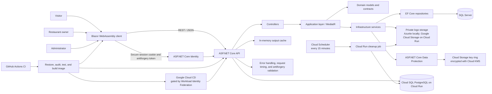

# LocalEats — Table & Thyme

LocalEats is a full-stack restaurant discovery and menu management application. Visitors can search restaurants and browse menus. Restaurant owners can manage their own listings and dishes after signing in. The application is based on the Restaurants API and Blazor client, with capstone patterns from the separate SkillSnap project.

## Project goals

This capstone brings together C#, ASP.NET Core, REST APIs, Blazor, EF Core, authentication, authorization, input validation, performance work, GitHub Actions, and project documentation. It is designed as a learning and portfolio project, not a production restaurant marketplace.

## Features

### Visitors

- Browse public restaurant and dish pages.
- Search, sort, and page through restaurant listings.
- View restaurant details, contact information, and menus.

### Restaurant owners

- Register and sign in.
- View their listings in **My restaurants**.
- Create and update their restaurant listings.
- Upload a restaurant logo.
- Create and edit dishes in their own menu.

### Platform behavior

- ASP.NET Core Identity uses an HttpOnly, Secure, SameSite=Strict session cookie for browser sign-in.
- Browser state-changing API requests include an antiforgery token; authentication tokens are not exposed to browser storage.
- The API checks roles and restaurant ownership; client-side controls are for usability only.
- Public catalog responses are cached for up to two minutes and invalidated after successful writes.
- Restaurant list queries use `AsNoTracking()` and paged results.
- Request timing and API errors are logged/handled by middleware.
- Restaurant and dish deletion is intentionally unavailable through the website and API. Data removal remains an administrative operation outside the app.

## Architecture



## Solution structure

| Path | Responsibility |
|---|---|
| `src/Restaurants.API` | HTTP endpoints, authentication setup, middleware, and OpenAPI |
| `src/Restaurants.Application` | Use cases, MediatR handlers, DTOs, and FluentValidation rules |
| `src/Restaurants.Domain` | Restaurant and dish entities, interfaces, and repository contracts |
| `src/Restaurants.Infrastructure` | EF Core, SQL Server, Identity, authorization, and blob storage |
| `src/Restaurants.Client` | Blazor WebAssembly pages, forms, cookie-aware API clients, and authentication state |
| `tests/Restaurants.APITests` | API-level tests |
| `tests/Restaurants.ApplicationTests` | Application and validation tests |
| `tests/Restaurants.InfrastructureTests` | Persistence and authorization tests |

The central data relationship is **Restaurant 1 → many Dishes**. Each restaurant has an Identity owner ID. The API checks that ID for owner-only changes.

## Technology

- ASP.NET Core 10 Web API and Blazor WebAssembly client targeting .NET 10
- C# and .NET SDK 10
- Entity Framework Core with SQL Server for local development and PostgreSQL for Google Cloud
- ASP.NET Core Identity API endpoints
- MediatR, FluentValidation, and AutoMapper
- Azurite for local logo-storage development; private Google Cloud Storage for Cloud Run
- Serilog, Swagger/OpenAPI, and GitHub Actions

## API overview

All routes use the `/api` prefix.

| Method | Endpoint | Access | Purpose |
|---|---|---|---|
| `GET` | `/restaurants` | Public | Search, sort, and page restaurant listings |
| `GET` | `/restaurants/{id}` | Public | View restaurant details |
| `GET` | `/restaurants/mine` | Owner role | List the signed-in owner's restaurants |
| `POST` | `/restaurants` | Owner role | Create a restaurant |
| `PATCH` | `/restaurants/{id}` | Signed in; owner checked by handler | Update a restaurant |
| `POST` | `/restaurants/{id}/logo` | Signed in; owner checked by handler | Upload a restaurant logo |
| `GET` | `/restaurants/{restaurantId}/dishes` | Public | List a restaurant's dishes |
| `GET` | `/restaurants/{restaurantId}/dishes/{dishId}` | Public | View one dish |
| `POST` | `/restaurants/{restaurantId}/dishes` | Signed in; owner checked by handler | Create a dish |
| `PUT` | `/restaurants/{restaurantId}/dishes/{dishId}` | Signed in; owner checked by handler | Update a dish |
| `POST` | `/identity/register` | Public | Register an account |
| `POST` | `/identity/login` | Public | Sign in and receive a secure session cookie |
| `POST` | `/identity/logout` | Signed in | End the current session |
| `GET` | `/identity/session` | Signed in | Read the current account and roles |
| `GET` | `/security/antiforgery` | Public | Issue a request token for browser form/API requests |
| `PATCH` | `/identity/user` | Signed in | Update the current account |
| `POST` / `DELETE` | `/identity/userRole` | Admin role | Assign or remove a user role |

There are no restaurant or dish `DELETE` endpoints by design. The API returns `401` for unauthenticated requests and `403` when an authenticated user is not allowed to perform a protected operation.

## Input validation, injection, and XSS protections

### Blazor forms

- Forms use DataAnnotations such as required fields, length limits, email/phone/postal-code formats, and numeric ranges.
- The `PlainText` validation attribute rejects markup delimiters and disallowed control characters in plain-text fields.
- `ClientInputSanitizer` normalizes Unicode, trims text, removes control characters, and converts optional blank fields to `null` before sending requests. It does not alter passwords.
- Search text is normalized and URL-escaped before it is sent to the API.

### API and rendering

- Client checks improve feedback but can be bypassed. The API repeats validation with FluentValidation and must remain the authoritative boundary.
- SQL injection is prevented by EF Core LINQ queries and parameterized Identity operations. Sort fields come from a fixed allowlist. Do not build SQL by concatenating user input; stripping SQL keywords is not a reliable defense and can damage legitimate search text.
- Blazor/Razor encodes ordinary string values when rendering HTML. The UI does not render user input as `MarkupString` or raw HTML. Keep it that way; rich HTML would need a separate sanitization policy.
- Browser sign-in uses an HttpOnly, Secure, SameSite=Strict cookie. The client does not store authentication tokens in `sessionStorage` or `localStorage`.
- State-changing API requests made with the authentication cookie are checked against an antiforgery request token. The browser client obtains this token from `/api/security/antiforgery` and sends it in `X-CSRF-TOKEN`.
- Logo uploads have a 5 MB limit, match extension, declared media type, signature, and a 40-megapixel dimension ceiling. The server generates the blob name. This metadata check does not decode and re-encode the image.
- Secrets and database credentials belong in user secrets or deployment secret storage, never in source control.

## Run locally

### Requirements

- .NET SDK 10.
- SQL Server LocalDB or another SQL Server connection.
- Azurite or an Azure Storage account for logo uploads.

The API development settings use local development configuration. Review `src/Restaurants.API/appsettings.Development.json` and keep any real credentials in user secrets or environment variables. The API applies pending EF Core migrations and seeds sample catalog data and roles at startup.

### Restore and build

From the repository root:

```powershell
dotnet restore .\Restaurants.API.sln
dotnet build .\Restaurants.API.sln --no-restore
```

### Start the API

In one terminal:

```powershell
dotnet run --project .\src\Restaurants.API\Restaurants.API.csproj
```

The HTTPS profile uses `https://localhost:7149`. Swagger is enabled in Development at `/swagger`.

### Start the Blazor client

In a second terminal:

```powershell
dotnet run --project .\src\Restaurants.Client\Restaurants.Client.csproj
```

The client uses `https://localhost:7055` and calls the API at `https://localhost:7149`. Development CORS must include the client origin. Cloud Run serves the client and API from one origin, so it does not need permissive cross-origin rules. For a different local port or a separate client host, allow only the exact HTTPS client origin.

### Owner access

New accounts do not automatically receive the `Owner` role. An administrator must grant it before the account can create a restaurant or use the owner workspace. The deployment/bootstrap process for the first Admin account must be handled securely; do not add a default production password to the repository.

## Performance and operations

- Public catalog output caching varies by query string and expires after two minutes.
- Restaurant create/update/logo upload and dish create/update invalidate the shared catalog cache tag.
- Restaurant list queries use `AsNoTracking()` and pagination.
- Request timing middleware and Serilog request logging provide basic runtime visibility.
- The in-memory cache is local to one API process. A multi-instance deployment needs distributed caching and coordinated invalidation.

## CI

`.github/workflows/main.yml` runs restore, dependency audit, Release build, tests, and a Docker build for pushes and pull requests to `main` and `develop`. `.github/workflows/deploy-gcp.yml` waits for a successful CI push, then can deploy the exact validated commit to Cloud Run. Development and Production deployments require separate GitHub environment variables, GitHub OIDC/Google Workload Identity Federation, and the `GCP_DEV_DEPLOY_ENABLED` or `GCP_PROD_DEPLOY_ENABLED` repository gate. Keep both gates unset or `false` until each environment is configured and reviewed. The deployer uses the custom no-delete Cloud Run role defined in `localeats-gcp-deployer-role.yaml`; do not replace it with Cloud Run Admin or Developer.

## Google Cloud Development deployment

- Live Development URL: <https://localeats-dev-449901250411.europe-central2.run.app>.
- The service, PostgreSQL database, logo bucket, KMS key, Secret Manager secrets, migration job, cleanup job, and Cloud Scheduler are documented in [GOOGLE_CLOUD_DEPLOYMENT_GUIDE.md](GOOGLE_CLOUD_DEPLOYMENT_GUIDE.md).
- Cloud Run changes have been deployed manually through Cloud Shell so far. The gated GitHub deployment workflow is prepared, but Workload Identity Federation and GitHub environment variables still need configuration before automatic deployment can run.
- Production is not provisioned. Keep its gate disabled until it has a separate project, database, bucket, KMS key, identities, secrets, backups, budget alerts, monitoring, and GitHub approval protection.

## Manual validation record

Use this checklist for local and deployed manual verification:

- [ ] Open the public restaurant list and verify search, sorting, pagination, details, and menu browsing.
- [x] Register, sign in, refresh the session, and sign out.
- [x] Confirm a different account cannot update another owner's restaurant; the cross-account `PATCH` returned `403 Forbidden`.
- [x] As an Owner, create/edit a restaurant, upload and display a logo, and create/edit a dish.
- [ ] Confirm the owner workspace lists only that owner's restaurants.
- [ ] Confirm public catalog results refresh after a write rather than showing cached stale values.
- [ ] Try invalid lengths, malformed email/phone/postal code, markup characters, control characters, and out-of-range numeric values in forms; confirm they are rejected or normalized before submission.
- [ ] Confirm Identity endpoints return HTTP 429 after the configured burst and inspect API security headers plus client CSP in browser developer tools.
- [ ] Check desktop and phone layouts, keyboard focus, labels, loading/empty/error messages, and image alternatives.
- [x] Run `dotnet test .\Restaurants.API.sln --no-restore`; the user reported 34 tests passing after the security updates.

### Validation status

- The user reported a Release solution build and 34 passing automated tests after the security changes.
- GitHub Actions run 47 passed for `main` commit `01a017576f9623dd7afcd636bedd8e34048768dc`.
- The user completed the Development browser walkthrough: sign-up/sign-in/session/logout, owner create/edit, logo upload/display, dish create/edit, cross-owner `403`, XSS-shaped input validation, SQL-shaped search, unsupported/oversized upload rejection, and signed-out owner-route handling.
- `/health`, the homepage, antiforgery token endpoint, and the Blazor PDB asset returned expected successful responses during Cloud Run checks. The user confirmed the duplicate navigation and normal unauthenticated error banner are fixed.
- The exact latest Cloud Run revision name was not recorded. Data Protection/database/logo persistence across a new revision, actual expiry cleanup after 24 hours, client-IP rate-limit behavior through Cloud Run, and Cloud SQL cost/credit review remain operational checks.

## Security controls implemented

- ASP.NET Core rate limits Identity endpoints (including register, login, and refresh) to 10 requests per minute per observed client IP, returning HTTP 429 when exceeded. Custom Identity controller endpoints use the same policy. Behind a reverse proxy, configure and trust forwarded headers only for known proxy addresses before relying on client IP partitioning; otherwise the API may see the proxy IP for all clients.
- Browser authentication uses an eight-hour, HttpOnly, Secure, SameSite=Strict session cookie. The Blazor client does not store access or refresh tokens in browser storage.
- Cookie-authenticated state-changing API requests are checked against an antiforgery token sent in `X-CSRF-TOKEN`; the token endpoint is `/api/security/antiforgery`.
- API responses include `X-Content-Type-Options`, `X-Frame-Options`, `Referrer-Policy`, and a restrictive `Permissions-Policy`. HSTS is enabled outside Development.
- The Blazor entry page has a Content Security Policy meta policy that restricts script and connection sources while allowing WebAssembly compilation and the app's Google Fonts. Since CSP in a meta tag cannot enforce every directive, the production static host should also emit the equivalent policy as an HTTP response header and set `frame-ancestors 'none'` there.
- Optional bootstrap Admin provisioning is idempotent and disabled unless both `BootstrapAdmin:Email` and `BootstrapAdmin:Password` are configured. The password goes through ASP.NET Core Identity hashing; it is never stored in source files. Existing accounts are not reset, but are granted the Admin role when bootstrap configuration is supplied.
- Successful Admin role assignment and removal events log the actor's user ID, target account email, role, and operation. Protect logs from unauthorized access and retain them according to the operator's policy.
- User text is normalized and validated; SQL is accessed through EF Core parameterized queries, and Razor encodes ordinary text output. Sanitization complements these controls and is not a substitute for them.
- Logo uploads are limited to 5 MB and 40 megapixels and checked against extension, declared media type, file signature, and image dimensions. The API does not currently decode/re-encode image bytes.

To provision the first local Admin, initialize .NET User Secrets and set both values in PowerShell (choose a unique, strong password):

```powershell
dotnet user-secrets init --project .\src\Restaurants.API\Restaurants.API.csproj
dotnet user-secrets set "BootstrapAdmin:Email" "admin@example.com" --project .\src\Restaurants.API\Restaurants.API.csproj
dotnet user-secrets set "BootstrapAdmin:Password" "<your-strong-password>" --project .\src\Restaurants.API\Restaurants.API.csproj
```

Start the API once so the account is created, then remove both settings with `dotnet user-secrets remove "BootstrapAdmin:Email" --project .\src\Restaurants.API\Restaurants.API.csproj` and the equivalent command for `BootstrapAdmin:Password`. Provisioning runs only when the database is reachable. For hosted environments, inject settings from an approved secret store, then remove them after successful first startup.

## Remaining security work

1. Verify the rate limiter's client IP behavior on Cloud Run. Do not trust arbitrary forwarded headers; use a verified proxy setup or edge rate limiting such as Cloud Armor where appropriate.
2. Consider server-side image decode/re-encode and malware scanning before accepting public uploads from real users.
3. Define an operational Admin recovery process and tamper-resistant audit retention if real user accounts are introduced.

## NEXT TO DEVELOP

1. **Automate Development deploys.** Configure GitHub Workload Identity Federation and the `Development` environment; keep `GCP_DEV_DEPLOY_ENABLED` off until IAM, branch restrictions, variables, migration job, and rollback behavior are reviewed. Then confirm a successful `develop` push deploys and passes health checks.
2. **Complete cloud operations verification.** Verify database records, logos, and Data Protection keys across a new Cloud Run revision; observe cleanup after the 24-hour retention period; confirm Cloud Run forwarded-IP behavior for rate limits; review Cloud SQL costs and budget alerts.
3. **Prepare Production separately.** Use a separate Google Cloud project and isolated database, logo bucket, KMS key, runtime/deployer identities, secrets, backups, monitoring, and budget alerts. Add required GitHub Production approval and test restore/rollback before enabling the gate.
4. **Scale caching deliberately.** The output cache is process-local. Before increasing Cloud Run above one instance, design distributed caching and cross-instance invalidation or retain the current single-instance cap.
5. **Strengthen public-upload handling.** Consider decoding and re-encoding logos and malware scanning before accepting uploads from real public users.
6. **Complete account operations.** Add email confirmation/recovery, a reviewed Admin recovery process, and durable audit-log retention before introducing real customer accounts.
