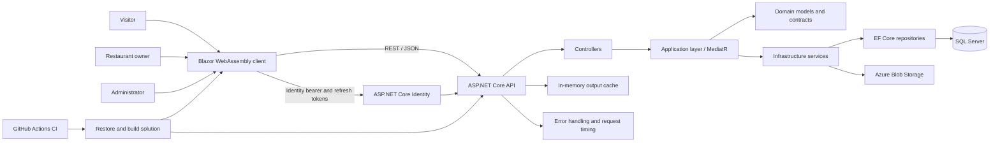

# LocalEats — Table & Thyme

LocalEats is a full-stack restaurant discovery and menu management application. Visitors can search restaurants and browse menus. Restaurant owners can manage their own listings and dishes after signing in. The application is based on the Restaurants API and Blazor client, with capstone patterns from the separate SkillSnap project.

## Project goals

This capstone brings together C#, ASP.NET Core, REST APIs, Blazor, EF Core, authentication, authorization, input validation, performance work, GitHub Actions, and project documentation. It is designed as a learning and portfolio project, not a production restaurant marketplace.

## Features

### Visitors

- Browse public restaurant and dish pages.
- Search, sort, and page through restaurant listings.
- View restaurant details, contact information, and menus.

### Restaurant owners

- Register and sign in.
- View their listings in **My restaurants**.
- Create and update their restaurant listings.
- Upload a restaurant logo.
- Create and edit dishes in their own menu.

### Platform behavior

- ASP.NET Core Identity issues short-lived bearer access tokens and refresh tokens.
- The API checks roles and restaurant ownership; client-side controls are for usability only.
- Public catalog responses are cached for up to two minutes and invalidated after successful writes.
- Restaurant list queries use `AsNoTracking()` and paged results.
- Request timing and API errors are logged/handled by middleware.
- Restaurant and dish deletion is intentionally unavailable through the website and API. Data removal remains an administrative operation outside the app.

## Architecture



## Solution structure

| Path | Responsibility |
|---|---|
| `src/Restaurants.API` | HTTP endpoints, authentication setup, middleware, and OpenAPI |
| `src/Restaurants.Application` | Use cases, MediatR handlers, DTOs, and FluentValidation rules |
| `src/Restaurants.Domain` | Restaurant and dish entities, interfaces, and repository contracts |
| `src/Restaurants.Infrastructure` | EF Core, SQL Server, Identity, authorization, and blob storage |
| `src/Restaurants.Client` | Blazor WebAssembly pages, forms, API clients, and browser token handling |
| `tests/Restaurants.APITests` | API-level tests |
| `tests/Restaurants.ApplicationTests` | Application and validation tests |
| `tests/Restaurants.InfrastructureTests` | Persistence and authorization tests |

The central data relationship is **Restaurant 1 → many Dishes**. Each restaurant has an Identity owner ID. The API checks that ID for owner-only changes.

## Technology

- ASP.NET Core 8 Web API
- Blazor WebAssembly client targeting .NET 9
- C# and .NET SDKs 8 and 9
- Entity Framework Core and SQL Server
- ASP.NET Core Identity API endpoints
- MediatR, FluentValidation, and AutoMapper
- Azure Blob Storage for restaurant logos
- Serilog, Swagger/OpenAPI, and GitHub Actions

## API overview

All routes use the `/api` prefix.

| Method | Endpoint | Access | Purpose |
|---|---|---|---|
| `GET` | `/restaurants` | Public | Search, sort, and page restaurant listings |
| `GET` | `/restaurants/{id}` | Public | View restaurant details |
| `GET` | `/restaurants/mine` | Owner role | List the signed-in owner's restaurants |
| `POST` | `/restaurants` | Owner role | Create a restaurant |
| `PATCH` | `/restaurants/{id}` | Signed in; owner checked by handler | Update a restaurant |
| `POST` | `/restaurants/{id}/logo` | Signed in; owner checked by handler | Upload a restaurant logo |
| `GET` | `/restaurants/{restaurantId}/dishes` | Public | List a restaurant's dishes |
| `GET` | `/restaurants/{restaurantId}/dishes/{dishId}` | Public | View one dish |
| `POST` | `/restaurants/{restaurantId}/dishes` | Signed in; owner checked by handler | Create a dish |
| `PUT` | `/restaurants/{restaurantId}/dishes/{dishId}` | Signed in; owner checked by handler | Update a dish |
| `POST` | `/identity/register` | Public | Register an account |
| `POST` | `/identity/login` | Public | Sign in and receive tokens |
| `POST` | `/identity/refresh` | Refresh token | Refresh an access token |
| `PATCH` | `/identity/user` | Signed in | Update the current account |
| `POST` / `DELETE` | `/identity/userRole` | Admin role | Assign or remove a user role |

There are no restaurant or dish `DELETE` endpoints by design. The API returns `401` for unauthenticated requests and `403` when an authenticated user is not allowed to perform a protected operation.

## Input validation, injection, and XSS protections

### Blazor forms

- Forms use DataAnnotations such as required fields, length limits, email/phone/postal-code formats, and numeric ranges.
- The `PlainText` validation attribute rejects markup delimiters and disallowed control characters in plain-text fields.
- `ClientInputSanitizer` normalizes Unicode, trims text, removes control characters, and converts optional blank fields to `null` before sending requests. It does not alter passwords.
- Search text is normalized and URL-escaped before it is sent to the API.

### API and rendering

- Client checks improve feedback but can be bypassed. The API repeats validation with FluentValidation and must remain the authoritative boundary.
- SQL injection is prevented by EF Core LINQ queries and parameterized Identity operations. Sort fields come from a fixed allowlist. Do not build SQL by concatenating user input; stripping SQL keywords is not a reliable defense and can damage legitimate search text.
- Blazor/Razor encodes ordinary string values when rendering HTML. The UI does not render user input as `MarkupString` or raw HTML. Keep it that way; rich HTML would need a separate sanitization policy.
- Logo uploads have a 5 MB limit and are checked against the extension, declared media type, and file signature. The server generates the blob name.
- Secrets and database credentials belong in user secrets or deployment secret storage, never in source control.

## Run locally

### Requirements

- .NET 8 and .NET 9 SDKs.
- SQL Server LocalDB or another SQL Server connection.
- Azurite or an Azure Storage account for logo uploads.

The API development settings use local development configuration. Review `src/Restaurants.API/appsettings.Development.json` and keep any real credentials in user secrets or environment variables. The API applies pending EF Core migrations and seeds sample catalog data and roles at startup.

### Restore and build

From the repository root:

```powershell
dotnet restore .\Restaurants.API.sln
dotnet build .\Restaurants.API.sln --no-restore
```

### Start the API

In one terminal:

```powershell
dotnet run --project .\src\Restaurants.API\Restaurants.API.csproj
```

The HTTPS profile uses `https://localhost:7149`. Swagger is enabled in Development at `/swagger`.

### Start the Blazor client

In a second terminal:

```powershell
dotnet run --project .\src\Restaurants.Client\Restaurants.Client.csproj
```

The client uses `https://localhost:7055` and calls the API at `https://localhost:7149`. Development CORS must include the client origin. For a different local port or a deployment, update `ApiBaseUrl` in client configuration and `AllowedOrigins` in API configuration.

### Owner access

New accounts do not automatically receive the `Owner` role. An administrator must grant it before the account can create a restaurant or use the owner workspace. The deployment/bootstrap process for the first Admin account must be handled securely; do not add a default production password to the repository.

## Performance and operations

- Public catalog output caching varies by query string and expires after two minutes.
- Restaurant create/update/logo upload and dish create/update invalidate the shared catalog cache tag.
- Restaurant list queries use `AsNoTracking()` and pagination.
- Request timing middleware and Serilog request logging provide basic runtime visibility.
- The in-memory cache is local to one API process. A multi-instance deployment needs distributed caching and coordinated invalidation.

## CI

`.github/workflows/main.yml` restores and builds the complete solution on pull requests to `main` or `master`, and supports manual runs. It installs both .NET SDK versions required by the API and client. The Azure release workflow is manual-only and will not run on a push; Azure deployment is intentionally paused for this capstone step.

## Step 11 validation checklist

Use this list for the local walkthrough:

- [ ] Open the public restaurant list and verify search, sorting, pagination, details, and menu browsing.
- [ ] Register, sign in, refresh an access token, and sign out.
- [ ] Confirm a non-owner cannot create or edit another user's restaurant or dishes.
- [ ] As an Owner, create a restaurant, update it, upload a logo, create a dish, and edit the dish.
- [ ] Confirm the owner workspace lists only that owner's restaurants.
- [ ] Confirm public catalog results refresh after a write rather than showing cached stale values.
- [ ] Try invalid lengths, malformed email/phone/postal code, markup characters, control characters, and out-of-range numeric values in forms; confirm they are rejected or normalized before submission.
- [ ] Confirm Identity endpoints return HTTP 429 after the configured burst and inspect API security headers plus client CSP in browser developer tools.
- [ ] Check desktop and phone layouts, keyboard focus, labels, loading/empty/error messages, and image alternatives.
- [ ] Run `dotnet test .\Restaurants.API.sln --no-restore` and record the actual result.

### Validation status

- The user's full-solution build passed after the owner workspace and dish-editing changes. After client input normalization, the standalone Blazor client build also passed with zero warnings; the API source has not changed since that full-solution build.
- Automated test execution and the browser-level walkthrough still need a confirmed result. The assistant execution environment's test run stalled before producing output; no passing test result is claimed here.
- The local API walkthrough also needs SQL Server LocalDB and Azurite available. LocalDB's instance registry could not be accessed in the assistant environment, and Azurite was not installed.
- Azure deployment has intentionally not been attempted.

## Security controls implemented

- ASP.NET Core rate limits Identity endpoints (including register, login, and refresh) to 10 requests per minute per observed client IP, returning HTTP 429 when exceeded. Custom Identity controller endpoints use the same policy. Behind a reverse proxy, configure and trust forwarded headers only for known proxy addresses before relying on client IP partitioning; otherwise the API may see the proxy IP for all clients.
- API responses include `X-Content-Type-Options`, `X-Frame-Options`, `Referrer-Policy`, and a restrictive `Permissions-Policy`. HSTS is enabled outside Development.
- The Blazor entry page has a Content Security Policy meta policy that restricts script and connection sources while allowing WebAssembly compilation and the app's Google Fonts. Since CSP in a meta tag cannot enforce every directive, the production static host should also emit the equivalent policy as an HTTP response header and set `frame-ancestors 'none'` there.
- Optional bootstrap Admin provisioning is idempotent and disabled unless both `BootstrapAdmin:Email` and `BootstrapAdmin:Password` are configured. The password goes through ASP.NET Core Identity hashing; it is never stored in source files. Existing accounts are not reset, but are granted the Admin role when bootstrap configuration is supplied.
- Successful Admin role assignment and removal events log the actor's user ID, target account email, role, and operation. Protect logs from unauthorized access and retain them according to the operator's policy.
- User text is normalized and validated; SQL is accessed through EF Core parameterized queries, and Razor encodes ordinary text output. Sanitization complements these controls and is not a substitute for them.

To provision the first local Admin, initialize .NET User Secrets and set both values in PowerShell (choose a unique, strong password):

```powershell
dotnet user-secrets init --project .\src\Restaurants.API\Restaurants.API.csproj
dotnet user-secrets set "BootstrapAdmin:Email" "admin@example.com" --project .\src\Restaurants.API\Restaurants.API.csproj
dotnet user-secrets set "BootstrapAdmin:Password" "<your-strong-password>" --project .\src\Restaurants.API\Restaurants.API.csproj
```

Start the API once so the account is created, then remove both settings with `dotnet user-secrets remove "BootstrapAdmin:Email" --project .\src\Restaurants.API\Restaurants.API.csproj` and the equivalent command for `BootstrapAdmin:Password`. Provisioning runs only when the database is reachable. For hosted environments, inject settings from an approved secret store, then remove them after successful first startup.

## Remaining security work

1. Verify the CSP against all routes and browser behaviors; configure it as an HTTP response header at the production static host before deployment.
2. Configure trusted forwarded headers and load-test/tune rate limits for the intended hosting topology.
3. Consider an OpenID Connect/BFF design with Secure, HttpOnly cookies if moving beyond a demo; the current browser token session is accessible to same-origin scripts.
4. Re-encode uploaded images server-side and consider malware scanning if arbitrary public uploads become a real requirement.
5. Define an operational Admin recovery process and tamper-resistant audit retention if real user accounts are introduced.

## AI assistance disclosure

Codex assisted with planning, code changes, and this documentation. Microsoft Copilot was not used in this environment; if the course submission requires Copilot evidence, collect it separately and describe it accurately.
